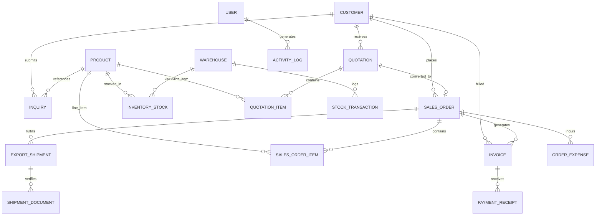

# ARROW ARO RICE – Website, CRM & Export Business Management System

> **A Complete .NET Full Stack B2B Platform for Indian Basmati & Non-Basmati Rice Trading, Export Logistics, Customer Relationship Management, and Financial Analytics.**


---

## 🌟 Executive Summary

**ARROW ARO RICE EXPORTS PVT LTD** is a Govt. of India recognized Star Export House with milling complexes in the Taraori Basmati belt (Karnal, Haryana) and CFS logistics hubs at **Mundra Port** (Gujarat) and **JNPT** (Mumbai). 

This platform provides an integrated enterprise solution tailored for international grain trade:
1. **Public B2B Portal**: Modern, responsive website showcasing authentic rice varieties (1121 XXL Steam, 1121 Golden Sella, 1509 Basmati, Traditional Raw, Sona Masoori, IR64 Parboiled), technical laboratory comparison matrix, container shipping logistics, certifications (APEDA, ISO 22000, HACCP, Halal, US FDA), live container tracking, and RFQ forms.
2. **Integrated CRM & ERP Suite**: International buyer dossiers, RFQ lead pipeline, Proforma Quotation builder with multi-currency calculation, confirmed sales orders, farmer procurement POs, warehouse stock ledger by batch & moisture test, maritime vessel & container tracking with 10 visual voyage milestones, export document verification, commercial invoices, payment receipts, and order-wise profitability analysis.

---

## 🚀 Quick Start Guide

### Prerequisites
- [.NET 10.0 SDK](https://dotnet.microsoft.com/) or later
- Visual Studio 2022 / VS Code / JetBrains Rider

### Clone & Run Locally

```bash
# 1. Navigate to the project directory
cd ARROW-ARO-RICE

# 2. Restore NuGet dependencies
dotnet restore

# 3. Build the application
dotnet build

# 4. Run the project
dotnet run
```

Access the application in your browser at:
- **Public Website**: `http://localhost:5000` or `https://localhost:5001`
- **Admin & CRM Portal**: `http://localhost:5000/Admin` (Login required)

---

## 🔐 Default Seeded Demo Accounts (Role-Based Access)

The database automatically seeds with realistic export data and role-based test credentials:

| Role | Email | Password | Primary Responsibilities |
| :--- | :--- | :--- | :--- |
| **Admin** | `admin@arrowarorice.com` | `Admin@2026#Rice` | Full executive access across all CRM, logistics, finance, and system audit logs. |
| **Sales** | `sales@arrowarorice.com` | `Sales@2026#Rice` | Lead qualification, customer dossiers, quotation builder, and sales orders. |
| **Inventory** | `inventory@arrowarorice.com` | `Inventory@2026#Rice` | Warehouse stock ledger, inward/outward dispatches, moisture logging, and shipments. |
| **Accounts** | `accounts@arrowarorice.com` | `Accounts@2026#Rice` | Commercial invoices, Swift wire transfers, order expenses, and profitability reports. |

> *Tip: The Login page includes 1-click credential buttons for each demo role for instant evaluation.*

---

## 🏛️ System Architecture & Technology Stack

- **Backend Framework**: ASP.NET Core MVC & REST Web API (.NET 10.0)
- **Data Access & ORM**: Entity Framework Core with Relational Schema & Foreign Keys
- **Database**: SQLite (`arrow_rice.db`) with zero-configuration setup (seamlessly portable to MS SQL Server or PostgreSQL)
- **Security & Identity**: Cookie Authentication, Claims-Based Authorization, and BCrypt password hashing
- **Frontend Architecture**: Razor Views, Vanilla CSS Design System with Bespoke Luxury Agriculture Palette (`#0a2916` deep emerald, `#d4af37` royal gold, `#fbfaf5` cream), Bootstrap 5.3, FontAwesome 6, and Chart.js
- **Reporting & Export**: UTF-8 CSV Excel Export Engine with BOM support for seamless viewing in Microsoft Excel

---

## 💾 Database Architecture, Standalone SQL & Database Studio

ARROW ARO RICE includes both a zero-configuration runtime relational database and complete standalone SQL scripts ready for enterprise RDBMS servers.

### 1. Active Database (Zero-Configuration)
- **Engine**: SQLite 3 via Microsoft Entity Framework Core 10.0 (`arrow_rice.db`).
- **Initialization**: Automatically created and seeded with realistic international grain export records on the first application launch.
- **Connection Configuration**: Configured in `appsettings.json`:
  ```json
  "ConnectionStrings": {
    "DefaultConnection": "Data Source=arrow_rice.db",
    "SqliteConnection": "Data Source=arrow_rice.db",
    "MySqlConnection": "Server=localhost;Port=3306;Database=arrow_aro_rice;User=root;Password=root;",
    "SqlServerConnection": "Server=localhost;Database=ArrowAroRiceDb;Trusted_Connection=True;TrustServerCertificate=True;"
  }
  ```

### 2. Standalone SQL Scripts (`/database` directory)
For teams using external database servers (MySQL, MariaDB, PostgreSQL, or MS SQL Server):
- [`database/schema.sql`](file:///e:/DOT-net-learn/ARROW-ARO-RICE/ARROW-ARO-RICE/database/schema.sql): Full DDL script creating all 19 relational tables, primary keys, auto-increment indexes, and foreign key relationships.
- [`database/seed_data.sql`](file:///e:/DOT-net-learn/ARROW-ARO-RICE/ARROW-ARO-RICE/database/seed_data.sql): Full DML script populating all seed data including staff accounts, international buyers, laboratory rice specs, warehouses, quotations, shipments, and invoices.

#### Importing into MySQL / phpMyAdmin:
1. Open MySQL Workbench or phpMyAdmin (`localhost:3306`).
2. Run `source database/schema.sql` (or import via phpMyAdmin "Import" tab).
3. Run `source database/seed_data.sql`.
4. Point `DefaultConnection` in `appsettings.json` to your MySQL instance.

### 3. Integrated Database Studio & Management Hub (`/Database`)
Logged in as **Admin**, navigate to **Database Studio & Hub** in the sidebar:
- **Relational Directory**: View real-time record counts for all 19 tables.
- **Table Browser**: Click "Browse" on any table to view, search, and page through raw records.
- **Table CSV Export**: Download instantaneous CSV dumps of any individual database table.
- **Interactive Read-Only SQL Studio**: Run queries (`SELECT ...`, `PRAGMA ...`) directly in the browser with execution timers and tabular output.
- **Direct Database Backup Download**: 1-Click download of the live `arrow_rice.db` file.
- **One-Click Script Downloads**: Instant access to `schema.sql` and `seed_data.sql`.
- **Integrity Verification**: Button to verify or re-seed the relational dataset anytime.

---

## 🗄️ Database Entity Relationship Model



### Relational Entities:
1. `User` - User credentials, hashed password, role (Admin, Sales, Inventory, Accounts).
2. `Customer` - International buyers, company details, VAT/tax IDs, import licenses, credit limits, payment terms.
3. `Inquiry` - Buyer RFQs, rice varieties, volumes, discharge ports, IncoTerms, pipeline statuses (`New`, `Contacted`, `QuotationSent`, `Converted`, `Lost`).
4. `Product` - Variety technical specs (Raw AGL mm, Moisture %, Broken %, Chalky %, Foreign matter, Admixture, Elongation, Kett whiteness, FOB pricing).
5. `Warehouse` - Silo and CFS storage complexes in Karnal, Mundra Port, and JNPT Mumbai.
6. `InventoryStock` - Real-time stock levels, batch numbers, moisture test logs, reserved allocations.
7. `StockTransaction` - Inward arrivals and outward export dispatches ledger.
8. `Quotation` & `QuotationItem` - Export proforma offers, multi-currency line items, freight, insurance, discount, and bank SWIFT coordinates.
9. `SalesOrder` & `SalesOrderItem` - Confirmed orders, customer PO references, and fulfillment schedules.
10. `ExportShipment` & `ShipmentDocument` - Container dispatches, shipping lines, vessel/voyage, B/L numbers, and verified export certificates.
11. `Invoice` & `PaymentReceipt` - Commercial billing, Swift TT / LC payment receipts, and balance tracking.
12. `OrderExpense` - Category-wise expenses (Ocean Freight, Inland Trailers, Customs CHA, SGS Inspection, Fumigation, Marine Insurance).
13. `ActivityLog` - Comprehensive system audit trail.

---

## 📦 Key Functional Modules

### 1. Public B2B Website
- **Home**: Hero banner, live container & B/L tracking widget, milling capacity highlights, featured products, export destinations map, certifications showcase.
- **About Us**: 25+ years company history, automated steam/parboiling plants in Karnal, Buhler optical sortex scanners, and temperature-controlled silos.
- **Products**: Filterable catalog of Basmati, Non-Basmati, and 100% Broken rice varieties with instant search.
- **Product Detail**: Detailed chemical and physical laboratory parameters, elongation ratios, packaging options, and direct RFQ modal.
- **Rice Specifications**: Technical laboratory specification matrix comparing all varieties with ASTM/APEDA standard testing methodologies.
- **Export Services**: Private labeling & custom packaging (BOPP, Non-Woven, Jute, Retail pouches), IncoTerms (FOB, CIF, CFR), SGS container inspection, and shipping logistics.
- **Quality Assurance**: 5-stage quality inspection workflow and certifications (APEDA, ISO 22000, HACCP, FSSAI, Halal, US FDA).
- **Contact Us & RFQ**: Comprehensive RFQ submission form, port offices, direct WhatsApp chat, and company export profile download.

### 2. CRM & Lead Management
- Automated unique RFQ numbering (`INQ-2026-0001`).
- Lead assignment to sales executives.
- Follow-up date scheduling and internal negotiation notes.
- 1-Click "Generate Quotation" from inquiry details.

### 3. Quotation Builder & Proforma Generator
- Multi-currency support (USD, EUR, AED, INR).
- Dynamic JavaScript line-item calculation (Metric Tons * Price/MT = Total).
- Automatic calculation of Ocean Freight, Marine Insurance, Terminal Handling, and Discounts.
- Formal Printable Export Proforma Invoice with Company Letterhead, GAFTA terms, and bank SWIFT instructions.
- 1-Click "Convert to Sales Order" which creates a linked Sales Order and generates a Commercial Invoice.

### 4. Warehouse & Inventory Ledger
- Stock levels across Karnal Silos, Mundra Port CFS, and JNPT Logistics Hub.
- Stock Inward receipt modal with batch number generation and laboratory moisture test logging.
- Stock Outward dispatch modal linked to export container stuffing references.
- Transaction movement audit trail and CSV export.

### 5. Maritime Shipment Tracker & Document Manager
- Live tracking by Container Number, Bill of Lading, or Booking Number.
- 10-Stage visual milestone journey tracker from factory processing to discharge port delivery.
- Statutory export documents manager: Commercial Invoice, Packing List, Certificate of Origin, Phytosanitary Certificate, SGS Quality Certificate, Bill of Lading, and Fumigation Certificate.

### 6. Finance & Profitability Analytics
- Commercial Invoices with due dates, payment status, and overdue alerts.
- Payment Receipts recording (Swift Wire Transfer, Letter of Credit, Cash Against Documents).
- Order-wise export expenses tracking.
- Order-wise Profitability statement comparing gross revenue against procurement and logistics costs with net profit margin (%) and Excel export.

---

## 📡 REST API Reference

| Endpoint | Method | Description |
| :--- | :--- | :--- |
| `/api/dashboard/inquiries-by-country` | `GET` | Geographic breakdown of buyer inquiries. |
| `/api/dashboard/sales-trend` | `GET` | Monthly export volume (MT) and revenue trend. |
| `/api/dashboard/variety-distribution` | `GET` | Export volume distribution by rice variety. |
| `/api/track/{trackingNumber}` | `GET` | Public lookup for container, B/L, or shipment tracking. |
| `/api/products?category={cat}` | `GET` | Filtered list of products and specifications. |

---

## 🧪 Testing the Complete Business Workflow

1. **Submit Inquiry**: Go to `/Contact` on the public website, fill out an inquiry for 50 MT of 1121 Steam Basmati to Jebel Ali, Dubai.
2. **Review Lead**: Log in as `sales@arrowarorice.com` (password `Sales@2026#Rice`), navigate to `/Inquiries`, open the new inquiry, update status to `Contacted`, and click **Generate Quotation**.
3. **Build Quotation**: Review auto-populated line items, freight, and insurance, then click **Save & Generate Proforma**.
4. **Approve & Convert**: Open the quotation, review the printable letterhead, mark status as `Accepted`, then click **Convert to Sales Order**.
5. **Initialize Shipment**: From the generated Sales Order, click **Initialize Export Shipment**, enter carrier booking and container numbers (`MSKU7821941`), and advance milestones to `In Transit`.
6. **Log Remittance**: Navigate to `/Finance/Invoices`, open the commercial invoice, click **Record Buyer Remittance**, and log 30% advance via Swift Wire Transfer.
7. **View Profitability**: Navigate to `/Finance/Profitability` to see the real-time net margin and export the statement to Excel.

---

## 🌐 Deployment Guidelines

### Linux / Kestrel / Systemd
```bash
dotnet publish -c Release -o ./publish
```
Configure Kestrel reverse-proxied behind Nginx or Apache with SSL certificates.

### Docker
```dockerfile
FROM mcr.microsoft.com/dotnet/aspnet:10.0 AS base
WORKDIR /app
EXPOSE 80
EXPOSE 443

FROM mcr.microsoft.com/dotnet/sdk:10.0 AS build
WORKDIR /src
COPY ["ARROW-ARO-RICE.csproj", "./"]
RUN dotnet restore
COPY . .
RUN dotnet publish -c Release -o /app/publish

FROM base AS final
WORKDIR /app
COPY --from=build /app/publish .
ENTRYPOINT ["dotnet", "ARROW-ARO-RICE.dll"]
```

---

## 📄 License & Attribution

Designed and engineered for **ARROW ARO RICE EXPORTS PVT LTD**. All rights reserved.
Govt. of India Recognized Star Export House | APEDA Registered | ISO 22000 | HACCP | Halal Certified.
