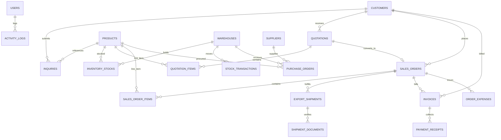

# ARROW ARO RICE – Database Schema & REST API Documentation

This document provides technical documentation for the **Database Relational Schema**, **Entity Relationships**, and **REST API Endpoints** of the ARROW ARO RICE system.

---

## 1. Database Architecture Overview

- **Active Runtime Database**: SQLite 3 (`arrow_rice.db`) managed via Microsoft Entity Framework Core 10.0.
- **RDBMS Portability**: 100% compatible with **MySQL 8.0+**, **MariaDB**, **PostgreSQL**, and **Microsoft SQL Server**.
- **Standalone SQL Scripts**:
  - [`database/schema.sql`](file:///e:/DOT-net-learn/ARROW-ARO-RICE/ARROW-ARO-RICE/database/schema.sql): Full DDL script creating 19 relational tables, indexes, constraints, and foreign key cascades.
  - [`database/seed_data.sql`](file:///e:/DOT-net-learn/ARROW-ARO-RICE/ARROW-ARO-RICE/database/seed_data.sql): Realistic DML export dataset including staff credentials, global buyers, lab rice specs, warehouse stock, orders, shipments, and invoices.
- **Connection Configuration** ([`appsettings.json`](file:///e:/DOT-net-learn/ARROW-ARO-RICE/ARROW-ARO-RICE/appsettings.json)):
  ```json
  "ConnectionStrings": {
    "DefaultConnection": "Data Source=arrow_rice.db",
    "SqliteConnection": "Data Source=arrow_rice.db",
    "MySqlConnection": "Server=localhost;Port=3306;Database=arrow_aro_rice;User=root;Password=root;",
    "SqlServerConnection": "Server=localhost;Database=ArrowAroRiceDb;Trusted_Connection=True;TrustServerCertificate=True;"
  }
  ```

---

## 2. Relational Entity-Relationship Diagram (ERD)



---

## 3. Database Schema Specification (19 Relational Tables)

### Module A: Authentication & System Security
1. **`Users`**
   - `Id` (INT, PK, Auto-Increment)
   - `Username` (VARCHAR 100, Unique, Not Null)
   - `Email` (VARCHAR 150, Unique, Not Null)
   - `PasswordHash` (VARCHAR 255, Not Null, BCrypt Encrypted)
   - `FullName` (VARCHAR 120, Not Null)
   - `Role` (VARCHAR 50, Not Null: `Admin`, `Sales`, `Inventory`, `Accounts`)
   - `Department` (VARCHAR 50, Nullable)
   - `IsActive` (TINYINT 1, Default 1)
   - `CreatedAt`, `LastLoginAt` (DATETIME)

2. **`ActivityLogs`**
   - `Id` (INT, PK, Auto-Increment)
   - `UserId` (INT, FK -> Users.Id, Nullable)
   - `UserName` (VARCHAR 120, Not Null)
   - `Action` (VARCHAR 100, Not Null)
   - `Module` (VARCHAR 100, Not Null)
   - `Details` (TEXT, Not Null)
   - `IpAddress` (VARCHAR 50, Nullable)
   - `Timestamp` (DATETIME, Default UTC)

### Module B: CRM & Buyer Relationships
3. **`Customers`**
   - `Id` (INT, PK, Auto-Increment)
   - `CompanyName` (VARCHAR 150, Not Null)
   - `ContactPerson` (VARCHAR 120, Not Null)
   - `Email`, `Phone`, `WhatsApp` (VARCHAR)
   - `Country`, `City`, `Address` (VARCHAR)
   - `TaxOrVatNumber`, `ImportLicenseNumber` (VARCHAR)
   - `PreferredDestinationPort` (VARCHAR 100)
   - `Status` (VARCHAR 50: `Active Buyer`, `Prospective`, `Inactive`)
   - `CreditLimitUsd` (DECIMAL 18,2)
   - `PaymentTerms` (VARCHAR 100)
   - `Notes` (TEXT)

4. **`Inquiries`**
   - `Id` (INT, PK, Auto-Increment)
   - `InquiryNumber` (VARCHAR 50, Unique: e.g. `INQ-2026-0001`)
   - `CustomerId` (INT, FK -> Customers.Id, Nullable)
   - `FullName`, `CompanyName`, `Email`, `Phone`, `Country` (VARCHAR)
   - `RiceVariety` (VARCHAR 100)
   - `ProductId` (INT, FK -> Products.Id, Nullable)
   - `QuantityMT` (DECIMAL 18,2, Not Null)
   - `DestinationPort`, `IncoTerm`, `PreferredPackaging` (VARCHAR)
   - `Message`, `InternalNotes` (TEXT)
   - `Status` (VARCHAR 50: `New`, `Contacted`, `QuotationSent`, `Converted`, `Lost`)
   - `Priority` (VARCHAR 50: `Low`, `Medium`, `High`, `Urgent`)
   - `AssignedToUserId` (INT, FK -> Users.Id, Nullable)
   - `FollowUpDate` (DATETIME, Nullable)

### Module C: Grain Catalog & Laboratory Technical Specs
5. **`Products`**
   - `Id` (INT, PK, Auto-Increment)
   - `Code` (VARCHAR 50, Unique: e.g. `RICE-1121-STM`)
   - `Name` (VARCHAR 150, Not Null)
   - `Category` (VARCHAR 100: `Basmati`, `Non-Basmati`, `Broken`)
   - `Variety` (VARCHAR 100: e.g. `1121 Basmati`, `1509 Basmati`, `Sona Masoori`)
   - `ProcessingType` (VARCHAR 100: `Steam`, `Golden Sella`, `Creamy Sella`, `Raw`)
   - `AverageLengthMm` (DECIMAL 18,2, e.g. `8.35` mm)
   - `MoistureMaxPercent` (DECIMAL 18,2, e.g. `12.50` %)
   - `BrokenMaxPercent` (DECIMAL 18,2, e.g. `1.00` %)
   - `ChalkyMaxPercent` (DECIMAL 18,2, e.g. `2.00` %)
   - `ForeignMatterMaxPercent` (DECIMAL 18,2, e.g. `0.05` %)
   - `AdmixtureMaxPercent` (DECIMAL 18,2, e.g. `5.00` %)
   - `ElongationRatio` (VARCHAR 100, e.g. `2.2x - 2.5x`)
   - `AromaGrade`, `KettWhiteness` (VARCHAR)
   - `PackagingOptions`, `MinOrderQuantityMT`, `DefaultFobPricePerMT`, `Currency`
   - `ImageUrl`, `IsActive`, `IsFeatured`

### Module D: Milling Complexes, Silos & Inventory
6. **`Warehouses`**
   - `Id` (INT, PK, Auto-Increment)
   - `Name`, `Code` (Unique), `Location`, `City`, `State`
   - `CapacityMT` (DECIMAL 18,2)
   - `ContactPerson`, `Phone`, `IsActive`

7. **`InventoryStocks`**
   - `Id` (INT, PK, Auto-Increment)
   - `WarehouseId` (INT, FK -> Warehouses.Id)
   - `ProductId` (INT, FK -> Products.Id)
   - `QuantityMT`, `ReservedMT` (DECIMAL 18,2)
   - `BatchNumber` (VARCHAR 100, Unique)
   - `MoistureTestedPercent` (DECIMAL 18,2)
   - `PackagingType`, `ReorderLevelMT`, `LastUpdated`

8. **`StockTransactions`**
   - `Id` (INT, PK, Auto-Increment)
   - `WarehouseId` (INT, FK -> Warehouses.Id)
   - `ProductId` (INT, FK -> Products.Id)
   - `QuantityMT` (DECIMAL 18,2)
   - `Type` (VARCHAR 50: `Inward`, `Outward`, `Adjustment`, `Reserved`)
   - `ReferenceNumber`, `Remarks`, `CreatedAt`

### Module E: Procurement & Mandis
9. **`Suppliers`**
   - `Id` (INT, PK, Auto-Increment)
   - `Name`, `SupplierType`, `Location`, `ContactPerson`, `Email`, `Phone`, `GstOrTaxNumber`, `RatingStars`

10. **`PurchaseOrders`**
    - `Id` (INT, PK, Auto-Increment)
    - `PoNumber` (VARCHAR 50, Unique)
    - `SupplierId` (INT, FK -> Suppliers.Id)
    - `WarehouseId` (INT, FK -> Warehouses.Id)
    - `ProductId` (INT, FK -> Products.Id)
    - `QuantityMT`, `UnitRatePerMT`, `TotalAmount`
    - `Status` (`Draft`, `Ordered`, `PartialReceived`, `Received`, `Cancelled`)
    - `QualityCheckRemarks`, `BatchNumberGenerated`

### Module F: Export Trading, Quotations & Sales Orders
11. **`Quotations`**
    - `Id` (INT, PK, Auto-Increment)
    - `QuotationNumber` (VARCHAR 50, Unique: e.g. `QT-2026-0001`)
    - `CustomerId` (INT, FK -> Customers.Id)
    - `QuotationDate`, `ValidityDate`
    - `IncoTerm` (`FOB`, `CIF`, `CFR`, `EXW`)
    - `PortOfLoading`, `PortOfDestination`
    - `Currency` (`USD`, `EUR`, `AED`, `INR`)
    - `SubTotal`, `FreightAmount`, `InsuranceAmount`, `DiscountAmount`, `GrandTotal`
    - `Status` (`Draft`, `Sent`, `Negotiating`, `Accepted`, `Declined`, `Expired`)
    - `BankDetails`, `PaymentTerms`, `SpecialTerms`

12. **`QuotationItems`**
    - `Id` (INT, PK, Auto-Increment)
    - `QuotationId` (INT, FK -> Quotations.Id)
    - `ProductId` (INT, FK -> Products.Id)
    - `ProductName`, `Variety`, `PackagingDescription`
    - `QuantityMT`, `UnitPricePerMT`, `LineTotal`

13. **`SalesOrders`**
    - `Id` (INT, PK, Auto-Increment)
    - `OrderNumber` (VARCHAR 50, Unique: e.g. `SO-2026-0001`)
    - `QuotationId` (INT, FK -> Quotations.Id, Nullable)
    - `CustomerId` (INT, FK -> Customers.Id)
    - `BuyerPoReference`, `OrderDate`, `ExpectedShipmentDate`
    - `IncoTerm`, `PortOfLoading`, `PortOfDestination`
    - `TotalQuantityMT`, `TotalAmount`, `Currency`
    - `Status` (`Draft`, `Confirmed`, `InProduction`, `ReadyToShip`, `Shipped`, `Delivered`, `Cancelled`)

14. **`SalesOrderItems`**
    - `Id` (INT, PK, Auto-Increment)
    - `SalesOrderId` (INT, FK -> SalesOrders.Id)
    - `ProductId` (INT, FK -> Products.Id)
    - `QuantityMT`, `UnitPricePerMT`, `LineTotal`

### Module G: Ocean Shipments & Export Documentation
15. **`ExportShipments`**
    - `Id` (INT, PK, Auto-Increment)
    - `ShipmentNumber` (VARCHAR 50, Unique: e.g. `SHP-2026-0001`)
    - `SalesOrderId` (INT, FK -> SalesOrders.Id)
    - `ShippingLine` (e.g. `Maersk Line`, `MSC`, `CMA CGM`)
    - `VesselName`, `VoyageNumber`, `BookingNumber`
    - `ContainerNumbers` (e.g. `MSKU7821941, MSKU7821942`)
    - `BillOfLadingNumber` (e.g. `MAEU289104821`)
    - `PortOfLoading`, `PortOfDestination`
    - `EstimatedDeparture`, `ActualDeparture`, `EstimatedArrival`, `ActualArrival`
    - `CurrentMilestone` (10-Stage Milestone: `BookingConfirmed`, `CargoReceivedPort`, `CustomsCleared`, `ContainerLoaded`, `VesselDeparted`, `InTransit`, `ArrivedTransshipment`, `VesselArrivedDestination`, `CustomsClearedDestination`, `Delivered`)
    - `StatusDescription`, `TrackingNotes`

16. **`ShipmentDocuments`**
    - `Id` (INT, PK, Auto-Increment)
    - `ExportShipmentId` (INT, FK -> ExportShipments.Id)
    - `DocType` (`BillOfLading`, `Phytosanitary`, `CertificateOfOrigin`, `SgsInspectionReport`, `FumigationCertificate`, `CommercialInvoice`, `PackingList`)
    - `Title`, `DocumentNumber`, `IssuingAuthority`, `IssueDate`, `FileUrl`, `IsVerified`

### Module H: Export Finance & Profitability
17. **`Invoices`**
    - `Id` (INT, PK, Auto-Increment)
    - `InvoiceNumber` (VARCHAR 50, Unique: e.g. `INV-2026-0001`)
    - `SalesOrderId` (INT, FK -> SalesOrders.Id)
    - `CustomerId` (INT, FK -> Customers.Id)
    - `InvoiceDate`, `DueDate`
    - `SubTotal`, `TaxOrDuty`, `GrandTotal`, `PaidAmount`, `Currency`
    - `Status` (`Draft`, `Issued`, `PartiallyPaid`, `Paid`, `Overdue`, `Cancelled`)
    - `BankSwiftDetails`, `Notes`

18. **`PaymentReceipts`**
    - `Id` (INT, PK, Auto-Increment)
    - `ReceiptNumber` (VARCHAR 50, Unique)
    - `InvoiceId` (INT, FK -> Invoices.Id)
    - `CustomerId` (INT, FK -> Customers.Id)
    - `Amount`, `Currency`, `PaymentDate`
    - `PaymentMethod` (`SwiftWireTransfer`, `LetterOfCreditAtSight`, `Cheque`, `AdvanceCash`)
    - `TransactionReference`, `BankName`, `Notes`

19. **`OrderExpenses`**
    - `Id` (INT, PK, Auto-Increment)
    - `SalesOrderId` (INT, FK -> SalesOrders.Id)
    - `Category` (`OceanFreight`, `InlandTransportTrailer`, `CustomsChaClearing`, `SgsInspectionTesting`, `FumigationPestControl`, `MarineCargoInsurance`, `PortThcHandling`, `PackagingLabelingBags`)
    - `Description`, `Amount`, `Currency`, `VendorName`, `ExpenseDate`, `InvoiceReference`

---

## 4. REST API Documentation

### Base URL: `http://localhost:5023/api`

### 1. Grain Products Catalog
- **Endpoint**: `GET /api/products`
- **Query Parameters**:
  - `category` (optional, string: `Basmati`, `Non-Basmati`, `Broken`, `All`)
- **Description**: Returns active rice varieties with lab specifications, minimum order quantity, and default FOB pricing.
- **Example Response (200 OK)**:
```json
[
  {
    "id": 1,
    "code": "RICE-1121-STM",
    "name": "1121 XXL Steam Basmati Rice",
    "category": "Basmati",
    "variety": "1121 Basmati",
    "averageLengthMm": 8.35,
    "moistureMaxPercent": 12.00,
    "brokenMaxPercent": 1.00,
    "defaultFobPricePerMT": 1150.00,
    "packagingOptions": "1kg, 5kg, 10kg, 20kg, 25kg, 50kg Non-Woven, BOPP, Jute & Poly Pouches",
    "minOrderQuantityMT": 25.00
  }
]
```

---

### 2. Live Shipment & Container Radar Tracking
- **Endpoint**: `GET /api/track/{trackingNumber}`
- **Route Parameters**:
  - `trackingNumber` (required, string: Container Number, B/L Number, Booking Number, or Shipment ID)
- **Description**: Public tracking endpoint for international buyers to monitor live vessel voyage, milestone progress, and verified export certificates.
- **Example Request**: `GET /api/track/MSKU7821941`
- **Example Response (200 OK)**:
```json
{
  "shipmentNumber": "SHP-2026-001",
  "shippingLine": "Maersk Line",
  "vesselName": "Maersk Mc-Kinney Moller",
  "voyageNumber": "2608W",
  "containerNumbers": "MSKU7821941, MSKU7821942",
  "billOfLadingNumber": "MAEU289104821",
  "portOfLoading": "Mundra Port (INMUN)",
  "portOfDestination": "Jebel Ali Port, Dubai (AEJEA)",
  "estimatedDeparture": "15 Oct 2026",
  "estimatedArrival": "24 Oct 2026",
  "milestone": "InTransit",
  "statusDescription": "Vessel departed Mundra Port. Navigating Arabian Sea towards Gulf of Oman.",
  "trackingNotes": "Temperature in container maintained at ambient dry. SGS Pre-Shipment Inspection Certificate verified.",
  "documents": [
    {
      "docType": "BillOfLading",
      "title": "Ocean Bill of Lading (Original Clean On Board)",
      "documentNumber": "BL-2026-001",
      "issuingAuthority": "Maersk Shipping Line"
    },
    {
      "docType": "Phytosanitary",
      "title": "Government Phytosanitary Certificate",
      "documentNumber": "PSC-IN-2026-9941",
      "issuingAuthority": "Plant Quarantine Dept, Ministry of Agriculture"
    },
    {
      "docType": "SgsInspectionReport",
      "title": "SGS Quality, Weight & Moisture Certificate",
      "documentNumber": "SGS-MND-88192",
      "issuingAuthority": "SGS India Pvt Ltd"
    }
  ]
}
```

---

### 3. CRM Dashboard: Inquiries by Country Feed
- **Endpoint**: `GET /api/dashboard/inquiries-by-country`
- **Description**: Supplies data for Chart.js geographic buyer origin analytics.
- **Example Response (200 OK)**:
```json
[
  { "country": "United Arab Emirates", "count": 18 },
  { "country": "Saudi Arabia", "count": 14 },
  { "country": "Germany", "count": 9 },
  { "country": "United States", "count": 7 },
  { "country": "Singapore", "count": 5 }
]
```

---

### 4. CRM Dashboard: Monthly Sales & Volume Trends
- **Endpoint**: `GET /api/dashboard/sales-trend`
- **Description**: Supplies data for Chart.js volume (Metric Tons) vs. revenue ($ USD) trends.
- **Example Response (200 OK)**:
```json
[
  { "month": "Aug 2026", "volumeMT": 250.0, "revenueUsd": 287500.0 },
  { "month": "Sep 2026", "volumeMT": 420.0, "revenueUsd": 495600.0 },
  { "month": "Oct 2026", "volumeMT": 680.0, "revenueUsd": 792400.0 }
]
```

---

### 5. CRM Dashboard: Top Variety Distribution
- **Endpoint**: `GET /api/dashboard/variety-distribution`
- **Description**: Supplies data for Chart.js doughnut chart breaking down export volume by grain type.
- **Example Response (200 OK)**:
```json
[
  { "variety": "1121 XXL Steam Basmati Rice", "volumeMT": 450.0 },
  { "variety": "1121 Golden Sella Basmati Rice", "volumeMT": 320.0 },
  { "variety": "Sona Masoori Raw Milled Rice", "volumeMT": 280.0 },
  { "variety": "IR64 Parboiled Rice (5% Broken)", "volumeMT": 210.0 }
]
```
